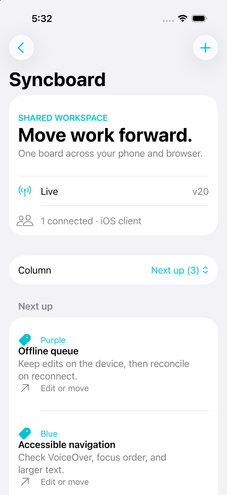

# Syncboard for iOS

A native SwiftUI client for [Syncboard](https://github.com/aryan-jaigirdar/syncboard). Create, edit, and move cards on the same board as a browser. Keep working offline, close the app, and reconnect without losing the saved outbox.

The app uses the real HTTP and WebSocket server. There is no mock backend in the application and no third-party Swift dependency.



## Try it

Requires Xcode 26 with Swift 6.2 or later and an iOS 26 simulator. The server must include durable operation receipts and the `ack` wire message. Use the paired server's `portfolio/mobile-ready-improvements` branch until those changes reach its default branch.

Start the paired server in its checkout:

```sh
npm ci
npm run build
npm run demo:seed
npm start
```

Open `Syncboard.xcodeproj`. Choose the Syncboard scheme and an iPhone simulator. Run the app, enter `http://127.0.0.1:3090`, and enter the board ID printed by the seeder. Open the same board in a browser. Edit a card on either surface and watch the other update.

The connection screen can also create a board. Remote servers require HTTPS. Local HTTP development is restricted to loopback addresses; a phone needs a reachable HTTPS server.

## What makes the sync interesting

- **Write before send.** The local confirmed snapshot, stable client ID, pending intents, and rejected drafts share one atomic JSON journal. A storage failure pauses sync rather than pretending a change was saved.
- **Retry without overwriting newer work.** The server persists a receipt with each accepted mutation. Replayed operation IDs receive an acknowledgement. The client drops the pending intent without applying it again to a newer snapshot.
- **Recover after relaunch.** Reconnecting always requests a full snapshot. The app then overlays and resends its saved pending operations. A version gap triggers another snapshot.
- **Keep rejected drafts.** An edit to a card removed by another client can be rejected. Its draft stays on the device. The native share sheet exports the complete intent, stable operation ID, and rejection reason as JSON.
- **One portable contract.** The Swift reducer handles all ten server mutation types. The same JSON fixture validates the TypeScript and Swift reducers. The native UI exposes card creation, editing, and moves.
- **Own the connection lifecycle.** SwiftUI owns the receive task. Cancellation closes its socket. A run lease prevents an older task from changing the current connection state.

Read the [architecture](docs/architecture.md) and [demo walkthrough](docs/demo.md) for the details and limits.

## Validation

```sh
swift test
python3 scripts/project.py
xcodebuild -project Syncboard.xcodeproj -scheme Syncboard \
  -destination 'generic/platform=iOS Simulator' \
  -derivedDataPath .build-output/xcode CODE_SIGNING_ALLOWED=NO build
```

Ten Swift Testing tests cover persistence, receipts after newer snapshots, matching actor IDs, rejected drafts, version gaps, move ordering, UTF-16 limits, endpoint validation, and every wire operation. Three parameter cases check that draft export preserves moves, labels, and multiline card text.

A separate XCTest journey ran in an iPhone 17 simulator on iOS 26.5. It created a card offline, terminated the app, relaunched it, and read the authoritative board through another WebSocket connection. The server contained exactly one matching card. See [the proof record](docs/proof.md).

Run that journey with the paired server already listening on port 3090:

```sh
xcodebuild -project Syncboard.xcodeproj -scheme Syncboard \
  -destination 'platform=iOS Simulator,id=YOUR_SIMULATOR_UDID' \
  -derivedDataPath .build-output/xcode \
  -resultBundlePath .build-output/offline-journey.xcresult \
  CODE_SIGNING_ALLOWED=NO test
```

Use a new result path for each run. The test creates a disposable board on the selected local server. GitHub Actions is configured for core tests and an unsigned simulator build. Hosted CI has not run yet.

## Scope and release limits

This is a working portfolio prototype. Board links authorize edits. There are no accounts, permissions, push notifications, or text merging. The server applies conflicting edits in arrival order. Offline editing starts after a board's first successful load. Pending intents are capped at 500. Receipt retention, public-server quotas, deployment, and authentication remain server concerns.

The journal is local plaintext app data. The app supports one window to keep one writer per board journal. Atomic writes run synchronously on the main actor; large boards would need an asynchronous storage design and measured performance work. VoiceOver and Dynamic Type use native controls, but a physical-device accessibility pass and signed distribution have not been completed.

## Layout

`Sources/SyncboardCore` contains the dependency-free state and persistence package. `App` contains the SwiftUI views and WebSocket session. `Tests` contains Swift Testing cases and the portable fixture. `UITests` contains the live offline journey. `scripts/project.py` deterministically generates the checked-in Xcode project.

MIT, see [LICENSE](LICENSE).
