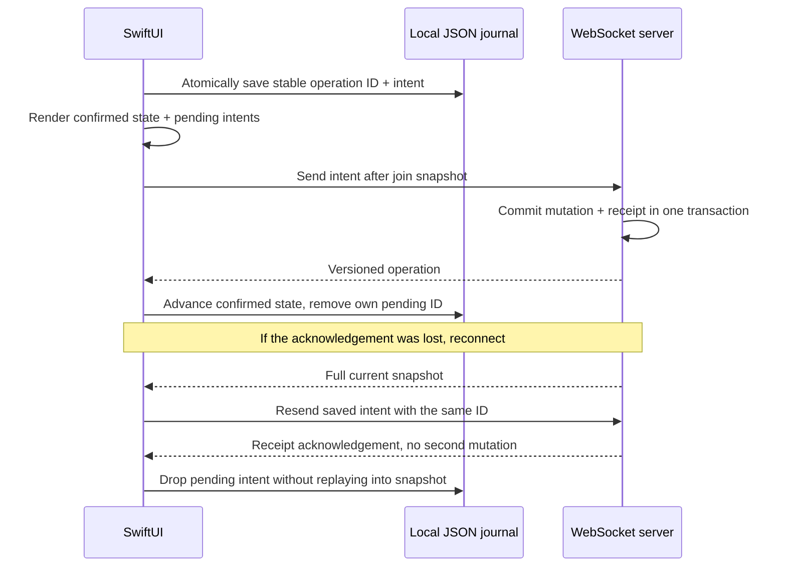

# Durable native sync

The paired Node server owns board state. Its SQLite transaction stores an operation receipt with each accepted mutation. The native client owns drafts until the server confirms or rejects them.

## State model

`SyncJournal` is a value type. It contains the client ID, last confirmed board, pending operations, and rejected changes. The visible board is derived by applying pending intents over confirmed state. A pending intent that cannot apply to a newer snapshot is retained until the server rejects it. Rendering a snapshot never silently discards a draft.

`JournalStore` encodes the complete journal and writes it atomically to an app-support file. The file name hashes the server URL and board link, so different boards and servers use different caches. The session exposes a change only after its updated journal is saved. Any storage error pauses the socket.

The app explicitly disables multiple windows. Atomic replacement prevents a partial write; it does not merge independent sessions' outboxes. One active window keeps one writer per journal. Rejected-draft export includes the complete intent, operation ID, and reason as JSON, so move and label drafts retain their recovery details.

`BoardReducer` implements the server's operation semantics, including remove-then-insert card moves and JavaScript UTF-16 text limits. The portable `sync-contract.json` fixture tests all ten mutation types against the TypeScript reducer's expected state. This is fixture parity, not a formal proof that every input is equivalent.

## Connection ownership

`BoardSession` is main-actor isolated and observable. The board's SwiftUI `.task` owns its receive loop. A cancellation handler closes that loop's socket. Each run has a unique lease, so an older task cannot overwrite a newer run's status. The independent outbox flush can be cancelled when pending IDs change without closing the receive loop's socket.

Every connection requests a full snapshot. Missing versions trigger another snapshot rather than applying operations over the wrong state. A receipt acknowledgement removes only its matching pending ID. Accepted broadcasts remove pending operations only when the server actor matches the saved client ID.

Each WebSocket limits received messages to 64 MiB. Foundation defaults to 1 MiB, which is too small for some valid boards. A snapshot containing 2,000 cards and 100 columns, with maximum text lengths escaped as JSON control characters, uses 64,073,519 bytes before presence entries. The board payload fits within the 67,108,864-byte budget. Presence entries also count toward that message limit.

## Deliberate limits

The server serializes edits by arrival order. It does not merge simultaneous text edits. A board link authorizes editing. The native UI exposes card create/edit/move; the reducer supports the broader server contract for incoming changes.

The journal is plaintext app storage and has no migration/version layer yet. It uses synchronous file writes on the main actor. The outbox cap is 500 intents; receipts are retained by the server for the board lifetime. Large-snapshot memory use, decoding time, and storage performance have not been measured. These choices keep the prototype's failure behavior understandable but need measured work before large deployments.
