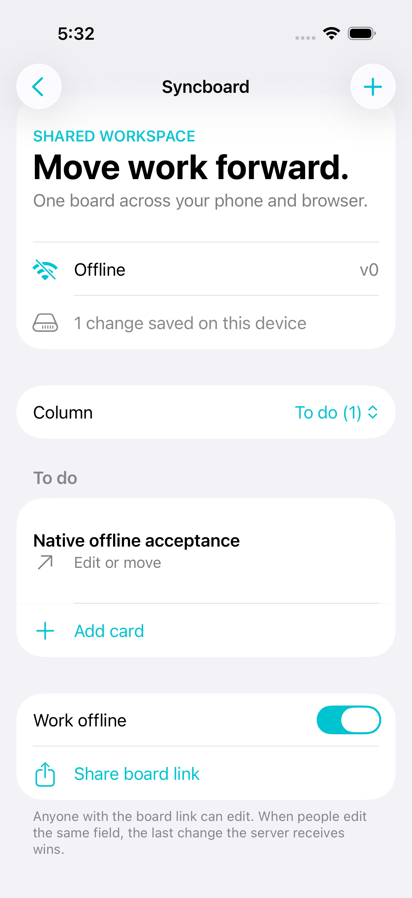
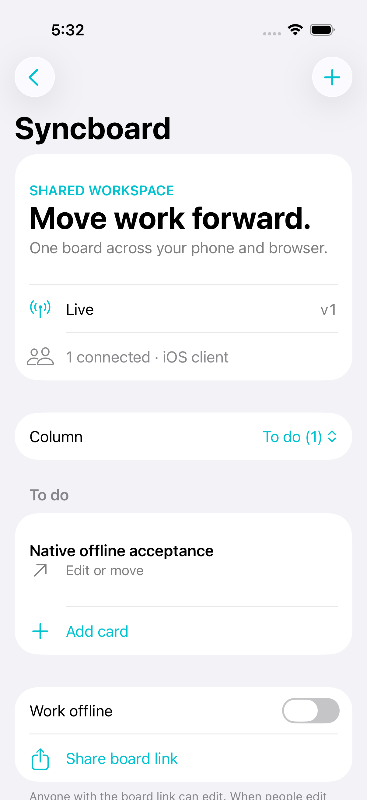

# Two-minute demo

Start the paired server and seeded board using the README. Use an iPhone simulator and a browser connected to the same board.

1. Show the iOS board in its Live state. Edit a title on the phone and confirm it in the browser.
2. Move the card with the native editor's column picker. Confirm both surfaces show its new column.
3. Enable Work offline. Create a card called “Offline draft”. Show the saved pending-change count.
4. Close and relaunch the app. Open the same board. Confirm the card remains visible and the app returns to Live.
5. Confirm the browser contains exactly one copy. The pending count clears after confirmation.
6. To show rejected-draft recovery, go offline, edit a card description, and delete that card from the browser. Reconnect the phone. Open the retained draft's Export draft share sheet.

This is a proposed walkthrough. The automated acceptance test covers steps 3–5 with a fresh server board and a separate WebSocket assertion. It does not automate the share sheet or rejected-draft walkthrough.

The screenshots below came from the passing XCTest run, not a mockup. The offline screenshot shows the draft saved on-device. The second screenshot shows the same card after a new process reconnects.

| Offline draft | Confirmed after relaunch |
| --- | --- |
|  |  |
